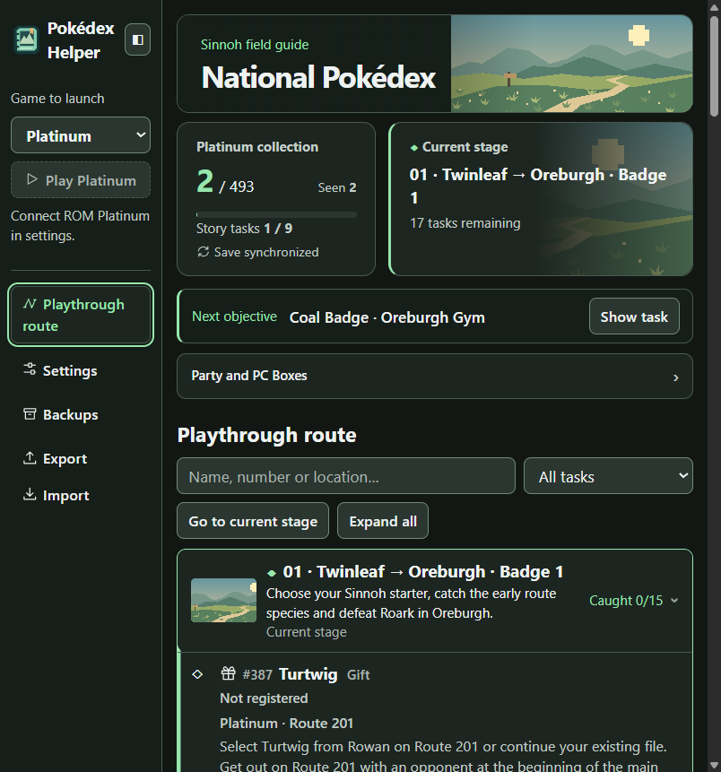
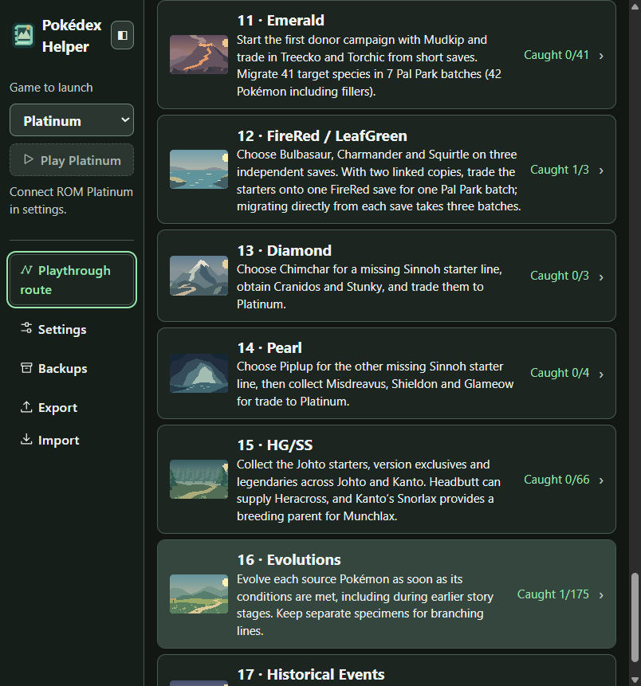
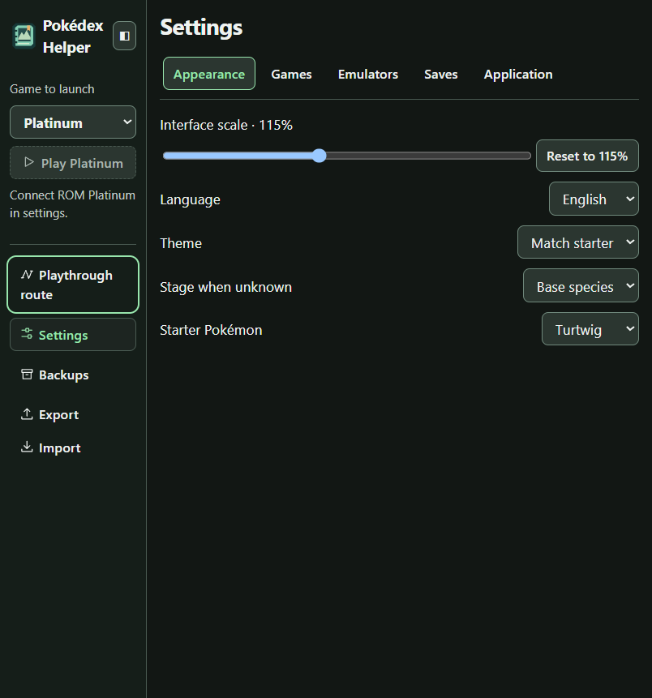

# Pokédex Helper

Pokédex Helper is a portable Windows field guide for completing the 493-species National Pokédex in **Pokémon Platinum USA**. Keep the guide beside your emulator to see the current story stage, find an acquisition method and check which registrations still belong in Platinum.

## Start a collection

1. On a Windows x86_64 PC, extract the complete portable ZIP to a writable folder. Launch **PokedexHelper.exe**. Allow room for your games, emulators and backups.
2. In setup, choose English or Russian and automatic or manual tracking. Automatic tracking reads local battery saves. Manual mode lets you record catches and story tasks from a physical console.
3. Import your own Platinum ROM and save. The Helper checks the files and copies them into its library. Add donor games as needed. Supported donors are Emerald, FireRed, LeafGreen, Diamond, Pearl, HeartGold and SoulSilver.
4. Connect melonDS for DS games or mGBA for GBA games. Install a supported official release with your consent, or import a supported official archive. Use the sidebar to select and launch a game.

## Follow the route

Nine Platinum story stages lead to the League. Platinum postgame remains accessible before the donor campaigns. Emerald is the first donor, followed by FireRed/LeafGreen, Diamond, Pearl and HeartGold/SoulSilver. Evolutions and historical events have dedicated sections. Search by species or location and open an encounter’s details for conditions and alternatives.

**Skip** moves an eligible rare encounter to a later method. Undo the skip to return to its earlier entry. In automatic mode only Platinum Caught Flags contribute to the total. A species registered in a donor is shown as awaiting transfer. Actual trades and migrations happen in the games.

## Manage saves and appearance

Use **Backups** to select a game and profile, inspect a battery save, create a copy, export it or restore it after closing the emulator. Automatic backups retain up to ten managed copies per profile. Historical files have a separate archive. **Settings** holds the language, starter theme, interface scale, ROMs, emulators and save connections. Original illustrations are local and static.

## Release candidate

The 493 route goals are checked structurally. Full gameplay, wireless trades, historical distributions and Gen III → IV Pal Park transfers still need owner verification. Pokédex Helper is an unofficial fan project. It is not affiliated with, endorsed by, or sponsored by Nintendo, Game Freak, or The Pokémon Company.

[Portable installation and updates](PORTABLE.md) · [Build from source](BUILDING.md) · [Privacy](PRIVACY.md) · [Third-party notices](THIRD_PARTY_NOTICES.md) · [Release status](RELEASE_CHECKLIST.md)
